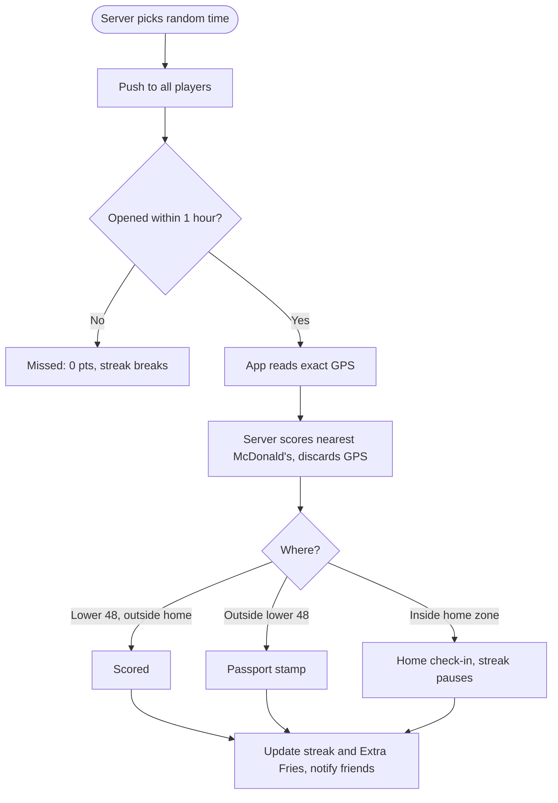

# Far From Fries: Functional Specification
*v0.1 · Complete · 2026-11-10*

| | |
|---|---|
| **Prepared by** | Benjamin |
| **Intended for** | Technical implementation / Claude build sessions |
| **Decisions Log** | [[Far From Fries - 02 Decisions Log]] |

---

## 1. Purpose

Far From Fries is a mobile social game that rewards exploring. Once a day, every player is pinged at the same random moment and scores points equal to their straight-line distance in miles from the nearest McDonald's. Friends compare scores on seasonal and all-time leaderboards, and the game never shares anyone's location, only their distance.

---

## 2. Goals

### 2.1 Primary Goals
- Make getting out and exploring feel rewarded, daily and over a season.
- Create a shared daily moment among friends (the synchronized ping and friend notifications).
- Be playable by people who refuse to share their location.

### 2.2 Secondary Goals
- A long-term collection goal (State Extremes tick list, Passport).
- A global leaderboard for wider bragging rights.

### 2.3 Out of Scope

> [!warning] Out of Scope (MVP)
> - Sharing friends' locations on any map
> - User-submitted McDonald's locations (phase 2)
> - Groups or teams; the model is a friend graph only
> - Anti-cheat beyond the 3-friend minimum for the global board
> - Android at launch (but the build must stay Android-ready)
> - Leaderboard scoring outside the lower 48

---

## 3. Core Product Principles

> [!abstract] Non-Negotiables
> - **Exploration is the rewarded action.** Being home earns nothing; being out earns points.
> - **Distance, never location.** No one else ever sees where you are. Exact GPS is used only to compute a score, then discarded.
> - **No always-on tracking.** Location is read only at a ping, an Extra Fries log, a State Extreme claim, or while the app is open in the foreground.
> - **No penalties.** Missing a ping scores zero; nothing is taken away.
> - **Scores are permanent.** A score locks when logged and is never recalculated.
> - **Straight-line distance, always.**

---

## 4. Users and External Entities

### 4.1 Internal Users

| User | Role | Access |
|------|------|--------|
| Player | Anyone with the app | Own home pin, friends, scores, streak, Extra Fries, Passport, Home log, State Extremes ticks |
| Friend | Another connected player | Your distances, scores and achievements only |

No admin role in MVP beyond maintaining the McDonald's dataset.

### 4.2 External Entities
- **McDonald's locations** (via AllThePlaces): reference data only. No affiliation.
- **Public land data** (USGS PAD-US): used to compute reachable State Extremes.

---

## 5. Functional Modules Overview

| Module | Description | Phase |
|--------|-------------|-------|
| Accounts and onboarding | Sign up, set home pin, add friends | MVP |
| Daily Ping | Synchronized random ping with 1-hour window | MVP |
| Scoring engine | Distance to nearest McDonald's, home zone, region rules | MVP |
| Streaks and Extra Fries | Streak tracking, earning and expiring bonus logs | MVP |
| Live distance and map | Big live distance readout; personal map with nearby McDonald's | MVP |
| Feed and notifications | Friend log notifications and activity feed | MVP |
| Leaderboards | Friends and global, seasonal and all-time | MVP |
| Passport and Home log | Out-of-bounds stamps and home check-ins | MVP |
| State Extremes | Per-state furthest points, claims, tick list | MVP |
| McDonald's dataset | Location data and computed State Extremes | MVP (internal) |
| Missing McDonald's submissions | User reports of missing locations | Phase 2 |

---

## 6. Functional Requirements

### 6.1 Accounts and Onboarding
- Sign in with email magic link, Apple, or Google. Choose a display name. Grant notification and location ("While Using the App") permission.
- Set a home pin. Home zone = 5-mile radius. The pin locks for the current season and can change only at a season boundary.
- Add friends (invite link, username search). Unlimited friends; friendship is mutual.
- Onboarding flow is subject to a dedicated wireframe and iteration pass during Build.

### 6.2 Daily Ping
- One national ping per day for all players, at a random time between 10 AM and 6 PM Pacific.
- Window: 1 hour from the notification. Opening the app in the window logs the player's location.
- Missed ping: 0 points, streak breaks, no other penalty.

### 6.3 Scoring
- Score = straight-line distance in miles to the nearest McDonald's, decimals allowed (1 mile = 1 point).
- Each result is classified as:

| Result | Condition | Leaderboard points | Streak | Extra Fries progress |
|--------|-----------|--------------------|--------|----------------------|
| Scored | Lower 48, outside home zone | Distance | Continues | Yes |
| Passport stamp | Outside lower 48 | 0 (distance shown on stamp) | Continues | Yes |
| Home check-in | Inside home zone | 0 | Pauses | No |
| Missed | No log in window | 0 | Breaks | No |

- Each score locks at log time; dataset changes never rescore it.
- Exact GPS is discarded after scoring. Stored: distance, result type, timestamp, region (state or country) only.

### 6.4 Streaks and Extra Fries
- Streak = consecutive qualifying pings (Scored or Passport). Home check-ins pause it.
- Every 7 qualifying pings earns 1 Extra Fries. At a streak of 12 or more, each qualifying ping counts double toward the next.
- Extra Fries let the player log at any moment they choose, scored like a normal ping.
- Each Extra Fries expires 2 weeks after it is earned; the app warns before expiry.

### 6.5 Live Distance and Map
- Home screen leads with a large live distance number to the nearest McDonald's, updating as the player moves (foreground only).
- Below it, a personal map: the player's exact position plus McDonald's within about 25 miles. No friends on the map.
- Live distance never logs or scores anything.

### 6.6 Feed and Notifications
- When a friend logs, notify: "Benjamin is 63.2 miles from the nearest McDonald's."
- Feed lists friends' logs (distance, result type) and achievements. No locations.
- State Extreme claims send a celebratory notification to all friends.

### 6.7 Leaderboards
- Friends board and global board, each with Season and All-time views.
- Seasons follow calendar seasons (summer, fall, winter, spring) and reset at each boundary.
- Ranking = sum of Scored points in the period.
- Global board requires at least 3 friends to appear.

### 6.8 Passport and Home Log
- Passport: one stamp per out-of-bounds log, showing country or region and distance.
- Home log: a plain record of home check-ins.

### 6.9 State Extremes
- One computed point per state (the reachable spot furthest from any McDonald's), plus a national point.
- Computed only over legally accessible public land, so every point is reachable.
- Claimable any time by being within 150 ft. No ping or Extra Fries needed.
- Claimable once per player. Awards a profile tick and achievement, plus that spot's distance as a normal log. Extra leaderboard points deferred to balancing.
- Points move with the monthly data refresh; earned ticks are permanent.
- A tab lists all points, shows distance to the nearest unclaimed one, and opens navigation to it.

---

## 7. Core Workflows

### 7.1 Daily Ping

1. Server picks the day's random time (10 AM to 6 PM Pacific) and notifies all players.
2. Player opens the app within 1 hour; the app reads exact GPS.
3. Server finds the nearest McDonald's, classifies the result, locks the score, discards GPS.
4. Streak and Extra Fries progress update; friends are notified with the distance.

### 7.2 Extra Fries Log
1. Player taps Use Extra Fries at a moment they choose.
2. Same as daily ping steps 2 to 4; one Extra Fries is spent.

### 7.3 State Extreme Claim
1. Player opens the State Extremes tab and navigates to a point.
2. Within 150 ft, player taps Claim; the app verifies distance to the point.
3. Tick and achievement are awarded, distance is logged, all friends get a celebration notification.

---

## 8. Suggested Data Entities

| Entity | Description |
|--------|-------------|
| `Player` | Display name, home pin (exact, private to the player), season lock, streak, Extra Fries count |
| `Friendship` | Two players, mutual |
| `Ping` | Daily ping time and window |
| `Log` | Player, timestamp, source (ping, Extra Fries, State Extreme), result type, distance, region. No coordinates |
| `ExtraFries` | Player, earned date, expiry, spent date |
| `Season` | Name, start, end |
| `McDonaldsLocation` | Coordinates, country, state, data version |
| `StateExtreme` | State, coordinates, distance to nearest McDonald's, data version, active |
| `Claim` | Player, StateExtreme, date |

---

## 9. Permissions and Roles

| Role | Permissions |
|------|-------------|
| **Player** | Read and write own profile, home pin and logs; manage own friendships; claim State Extremes |
| **Friend** | Read another player's distances, results, scores and achievements; never coordinates or home pin |

---

## 10. Non-Functional Requirements

### 10.1 Reliability
A log made inside the window must never be lost; if the network drops, the app queues it with its timestamp.

### 10.2 Transparency
Each log shows its result type (Scored, Passport, Home) so players understand why a score is what it is.

### 10.3 Maintainability
McDonald's data refreshes monthly without code changes. Home radius, ping window and Extra Fries rates should be configurable.

### 10.4 Privacy and Battery
No other player can access any player's coordinates. Logs store no coordinates. The home pin is stored only to test the home zone. No background location tracking.

### 10.5 Portability
Cross-platform codebase; Android must ship with minimal extra work.

### 10.6 Branding
Avoid McDonald's trademarks ("Mc" names, Happy Meal) in the app's branding; include a "not affiliated" note.

Visual style: Field Notes meets a summit register (Decision #27). Bold uppercase sans type (except the lowercase "c" in McFarthest), thin ruled lines and boxed form fields, sharp square corners (no rounding), sections as thin-stroked outline boxes with a margin, no background fills, #EED202 background with dark ink, flat print look. Reference design: direction A on the canvas https://claude.ai/artifact/PBTz9CKozTxYmiiYRwKmn8. Navigation is a single Home screen with Me behind a person icon (Decision #40); State Extremes and Top 100 are called Ticks (Decision #39).

### 10.7 Integrations

| Service | Integration | Phase |
|---------|-------------|-------|
| AllThePlaces | McDonald's locations, monthly import | MVP |
| USGS PAD-US | Public land for State Extremes | MVP |
| APNs via Expo push | Pings and friend notifications | MVP |
| Apple and Google sign-in | Authentication | MVP |

---

## 11. Implementation Roadmap

### MVP
- [ ] McDonald's dataset and computed State Extremes
- [ ] Accounts, home pin, friends
- [ ] Daily ping, scoring, locked scores
- [ ] Streaks and Extra Fries
- [ ] Live distance and personal map
- [ ] Feed, notifications, friends and global leaderboards
- [ ] Passport, Home log, State Extremes tab

### Phase 2
- [ ] Android release
- [ ] Missing McDonald's submissions
- [ ] Points rebrand (fries or burgers)
- [ ] State Extremes bonus point balancing
- [ ] **Check-in Live Activity** (iOS lock screen + Dynamic Island) instead of a plain push. Starts 30 minutes before check-in opens and stays up until the window closes, with the countdown and your current miles from McDonald's. Tapping it checks you in for the day. Open questions: (1) a live mileage number needs location while the app is closed, which breaks the "no background tracking" promise (10.4), so either show the miles from when the app was last open or ask for background location as an opt-in; (2) starting it remotely needs ActivityKit push tokens sent from `push-dispatch`; (3) tap-to-check-in can open the app straight into a check-in (deep link) or run an App Intent, but location still needs the app in the foreground under when-in-use permission.

---

## 12. Success Criteria

> [!success] The application is successful if it:
> - [ ] Most players in a friend circle log on most days.
> - [ ] Players report going somewhere new to raise their score.
> - [ ] At least one State Extreme is claimed by a test player.
> - [ ] No coordinates are exposed to other players in testing.

---

*Spec complete → [[Far From Fries - 04 Architect]]*
