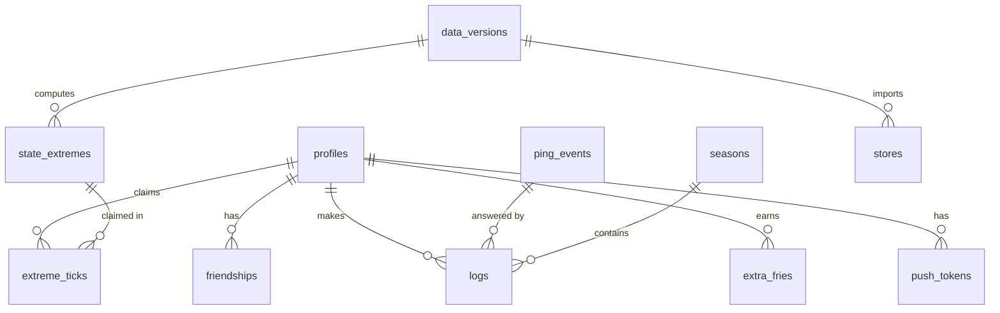

# Far From Fries: Architect
*Stage 4 · Technical Design · 2026-11-10*

> [!abstract] How to Use
> How the product gets built. Turns [[Far From Fries - 03 Functional Spec]] into technical decisions so a build session can start without major architectural choices.

---

## 1. Build vs. Borrow Analysis

| Capability | What Exists | Approach | Notes |
|------------|-------------|----------|-------|
| McDonald's locations | AllThePlaces | Adopt | Monthly import; US, Canada, Mexico |
| Auth | Supabase Auth | Adopt | Email magic link, Apple, Google |
| Nearest-store lookup | PostGIS | Wrap | One `score_location` DB function |
| Daily ping scheduler | pg_cron + Edge Functions | Wrap | Random daily time, Expo push |
| Push notifications | Expo push to APNs | Adopt | |
| Maps | react-native-maps (Apple Maps) | Adopt | Free on iOS |
| Email | Resend | Adopt | Sign-in and account email |
| Invite links | Vercel landing page + universal links | Integrate | |
| Reachable public land | USGS PAD-US | Adopt | Filter to open public access |
| State Extremes calculation | Nothing adequate | Build | Python pipeline |
| Game logic (streaks, Extra Fries, leaderboards) | Nothing | Build | DB functions and views |

---

## 2. Selection Research

### Tools Evaluated

| Tool | What It Does | Pros | Cons | Decision |
|------|-------------|------|------|----------|
| AllThePlaces | Open chain-location dataset | Free, broad coverage | Can miss stores or keep closed ones | Use |
| Scraping McDonald's locator | Official store data | Most complete | Against terms of service | Skip |
| Commercial store datasets | Paid chain lists | Accurate, legal | Cost, re-buy to stay current | Monitor (one-time check) |
| Supabase | Auth, Postgres/PostGIS, cron, functions | Geospatial queries built in; standard stack | | Use |
| Firebase | Auth, document DB, functions | Easy start | No real nearest-point geo query | Skip |
| React Native + Expo | Cross-platform app | One codebase, push, location, maps | | Use |
| Flutter | Cross-platform app | Fast UI | Outside the usual stack | Skip |

### Key Findings
- The McDonald's data choice came from an earlier research thread: AllThePlaces, refreshed monthly.
- Matches Benjamin's standard stack from past projects (e.g. PoopSafe: Supabase, Resend; plus Vercel).

---

## 3. Tech Stack

| Layer | Choice | Rationale | Alternatives Considered |
|-------|--------|-----------|------------------------|
| **Runtime / Language** | TypeScript (app, Edge Functions), Python (pipeline) | Expo standard; geopandas for geo work | |
| **Framework** | React Native with Expo, Expo Router | iOS first, Android-ready | Flutter, native Swift |
| **Database** | Supabase Postgres + PostGIS | Nearest-store queries | Firebase |
| **Auth** | Supabase Auth: email magic link, Apple, Google | Apple expected on iOS; Google for Android | Email only |
| **File / Document Storage** | Not needed in MVP | | |
| **Background Jobs** | pg_cron + Supabase Edge Functions | Daily ping, notifications, expiry | |
| **External APIs / Services** | Expo push, Resend, AllThePlaces, PAD-US | | |
| **Deployment** | App Store via EAS; Vercel for web | | |
| **Dev Environment** | Mac, Expo dev client, Supabase CLI | | |

---

## 4. Data Model Sketch

No exact ping location is ever stored. The exact point goes into a scoring function, which returns the distance, and is then discarded.



### Key Entities

| Entity | Key Fields | Notes |
|--------|-----------|-------|
| `profiles` | id, display_name, home_point, home_locked_season_id, streak_count | home_point is exact and private to its owner (row-level security) |
| `friendships` | user_a, user_b, status, created_at | Mutual; pending until accepted |
| `seasons` | id, name, starts_at, ends_at | Calendar seasons |
| `ping_events` | id, fires_at, window_ends_at | One national ping per day, random 10 AM to 6 PM Pacific |
| `logs` | id, user_id, ping_event_id, kind, zone, distance_mi, region, season_id, created_at | kind: ping, extra_fries, state_extreme. zone: scoring, home, passport. region: state or country only |
| `extra_fries` | id, user_id, earned_at, expires_at, used_log_id | Expires 2 weeks after earning |
| `stores` | id, geom, country, state, data_version | AllThePlaces import |
| `state_extremes` | id, state, geom, distance_mi, data_version, active | One active point per state, plus a national row |
| `extreme_ticks` | user_id, state, extreme_id, claimed_at | Permanent; one per user per state |
| `push_tokens` | user_id, expo_token | For pings and friend alerts |
| `data_versions` | id, source, imported_at | One row per monthly refresh |

Leaderboards (season, all-time, friends, global) are database views over `logs`; global includes only players with 3 or more friends.

---

## 5. Integration Points

### AllThePlaces (McDonald's locations)
- **Purpose:** source of store locations
- **Auth method:** none (public dataset)
- **Direction:** inbound
- **MVP or Phase 2:** MVP
- **Failure behavior:** keep the previous data version; scores already logged are unaffected
- **Notes:** monthly import into `stores`; import US, Canada and Mexico; compare once against a second source to gauge gaps

### USGS PAD-US (public land)
- **Purpose:** restrict State Extremes to reachable public land
- **Auth method:** none (public download)
- **Direction:** inbound (pipeline only)
- **MVP or Phase 2:** MVP
- **Failure behavior:** keep current State Extremes
- **Notes:** keep parcels marked open to public access

### Expo Push / APNs
- **Purpose:** daily ping, friend notifications, Extra Fries expiry warnings, State Extreme celebrations
- **Auth method:** Expo access token, APNs key
- **Direction:** outbound
- **MVP or Phase 2:** MVP
- **Failure behavior:** the 1-hour window absorbs delays; send in batches
- **Notes:** Android uses the same Expo push path later

### Resend
- **Purpose:** sign-in and account email
- **Auth method:** API key (Supabase SMTP)
- **Direction:** outbound
- **MVP or Phase 2:** MVP
- **Failure behavior:** Apple and Google sign-in still work

### Vercel (web)
- **Purpose:** landing page, friend invite links that open the app (universal links)
- **Direction:** inbound (users)
- **MVP or Phase 2:** MVP

---

## 6. State Extremes Pipeline

Offline Python job (geopandas, scipy KD-tree), results loaded into Supabase.

1. **McDonald's points:** AllThePlaces, US plus Canada and Mexico, so border-state distances respect stores just across the line.
2. **Reachable land:** USGS PAD-US, keeping only parcels marked open to public access.
3. **Distance grid:** sample each state on a grid of about 100 m, compute distance to the nearest McDonald's, mask to reachable land.
4. **Pick and refine:** take the best cell per state, refine locally to the exact point (a few meters). The national point is the max across all states.
5. **Review:** a quick manual check of each point on satellite imagery before publishing.

- The grid only finds the neighborhood; the true max is within about 70 m of a grid point, and refinement pins it down well inside the 150 ft claim radius.
- Ping scoring never uses the grid (exact PostGIS distance).
- Points move with the monthly data refresh; earned ticks are permanent.
- Switch to the exact Voronoi method only if the grid is too slow.

---

## 7. What Claude Will Build

> [!todo] Build Scope
> *Ordered roughly by dependency.*

- [ ] Supabase project: schema, PostGIS, row-level security
- [ ] Store import script (AllThePlaces to `stores`) and monthly refresh job
- [ ] `score_location` function: exact point in, distance, zone and region out, nothing stored
- [ ] Expo app shell, sign-in (email via Resend, Apple, Google), profile and home pin
- [ ] Onboarding: wireframe and iterate (see Handoff Notes); keep screens easy to rearrange
- [ ] Home view: live distance readout and Apple Maps with stores within about 25 miles
- [ ] Friends and invite links (Vercel landing page with universal links)
- [ ] Daily ping: pg_cron picks the time, Edge Function sends Expo push, 1-hour log window, scoring
- [ ] Friend activity feed and "Benjamin is 63.2 miles from the nearest McDonald's" notifications
- [ ] Streaks (pause in home zone, break on a miss) and Extra Fries
- [ ] Leaderboards: season, all-time, global
- [ ] Passport and Home logs
- [ ] State Extremes: pipeline, tab, 150 ft claim check, friend broadcast
- [ ] TestFlight with the friend group

---

## 8. File / Folder Structure

```
far-from-fries/
├── app/                 ← Expo Router screens (home map, leaderboard, feed, extremes, profile)
├── components/          ← shared UI (distance readout, friend rows, tick list)
├── lib/                 ← Supabase client, location, push helpers
├── supabase/
│   ├── migrations/      ← schema, views, RLS policies
│   └── functions/       ← Edge Functions (send-ping, notify-friends)
├── pipeline/            ← Python: store import, State Extremes calculation
├── web/                 ← Vercel landing page and invite-link handling
├── docs/                ← Explore, Decisions Log, Spec, Architect
└── CLAUDE.md            ← key constraints for build sessions
```

---

## 9. Open Technical Questions

- [x] Grid or exact Voronoi for State Extremes: grid; Voronoi only if too slow.
- [x] Sign-in: email magic link, Sign in with Apple, and Google from day one.
- [x] Location permission: "While Using the App" only; no background tracking.

---

## 10. Risk Log

| Risk | Likelihood | Impact | Mitigation |
|------|-----------|--------|------------|
| Push notifications arrive late or in bursts | Med | Med | The 1-hour window absorbs delays; send in batches |
| Exact location leaks into logs or analytics | Low | High | Score inside one database function; never log request bodies; audit before launch |
| AllThePlaces misses stores or keeps closed ones | Med | Med | Compare against a second source once; monthly refresh; user submissions in phase 2 |
| App Store review flags use of the McDonald's name | Med | High | Generic branding, a clear "not affiliated" note, McDonald's mentioned only as the data reference |
| GPS spoofing on the global board | Med | Low | Accepted risk; 3-friend minimum |
| State Extremes job is slow across the lower 48 | Med | Low | Run offline; use the exact Voronoi method if the grid is too slow |

---

*Architect complete → ==ready for Build handoff==*
